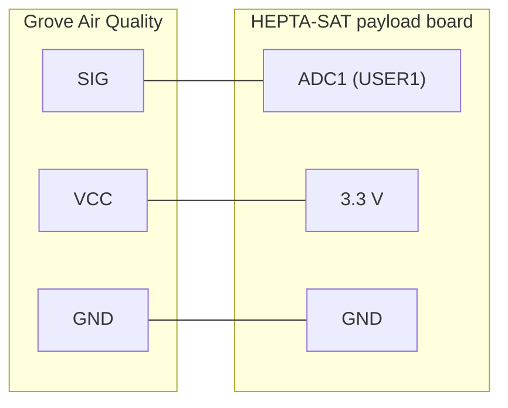

# Lab7-sample_air-quality-sensor

HEPTA-SAT training sample: **Grove Air Quality Sensor v1.3** (Winsen **MP503**).

## Sensor Specifications

| Item | Value |
|------|-------|
| Module | **Seeed Grove Air Quality Sensor v1.3** |
| Gas sensor | **Winsen MP503** (semiconductor type) |
| Interface | Analog output → **USER1 / USER2 / USER3** (V4.1.1) |
| Supply | 3.3 to 5 V (Grove module) |
| Detects | Alcohol, smoke, isobutane, formaldehyde, etc. |
| Warm-up | approx. 20 s (countdown printed in the sketch) |
| Classification | Seeed `slope()` algorithm (thresholds scaled ×4 for 12-bit) |

## Wiring (HEPTA-SAT V4.1.1)

| Sensor | HEPTA-SAT |
|--------|-----------|
| SIG (analog output) | **ADC1** (`USER1` in the sketch) |
| VCC | 3.3 V payload (`eps.switch_3V3_on()`) |
| GND | GND |

The sketch uses `air_quality.begin_after_warmup(USER1)`. For a different connection, use `USER2` for **ADC2** or `USER3` for **ADC3**. The sketch counts down 20 seconds before calling this method.



## Build and Upload

1. Open `Lab7-sample_air-quality-sensor.ino` in the Arduino IDE
2. Board: **Generic RP2350**
3. Check out the `src/` submodule (`git submodule update --init`)
4. Compile and upload
5. Serial monitor at **9600 baud**

## Example Serial Output

```
Warming up air quality sensor...
Warming up... 1/20 s
Warming up... 2/20 s
...
Warming up... 20/20 s
Air quality sensor ready
Air quality: 512 (Fresh air)
Air quality: 800 (Low pollution)
```

## Driver

- Board interface: `HeptaAirQualityMp503` from `src/HeptaSat.h`
- `src/drv/air_quality_mp503.h` / `.cpp`
- Details: `src/docs/drivers/air-quality-mp503.md`
